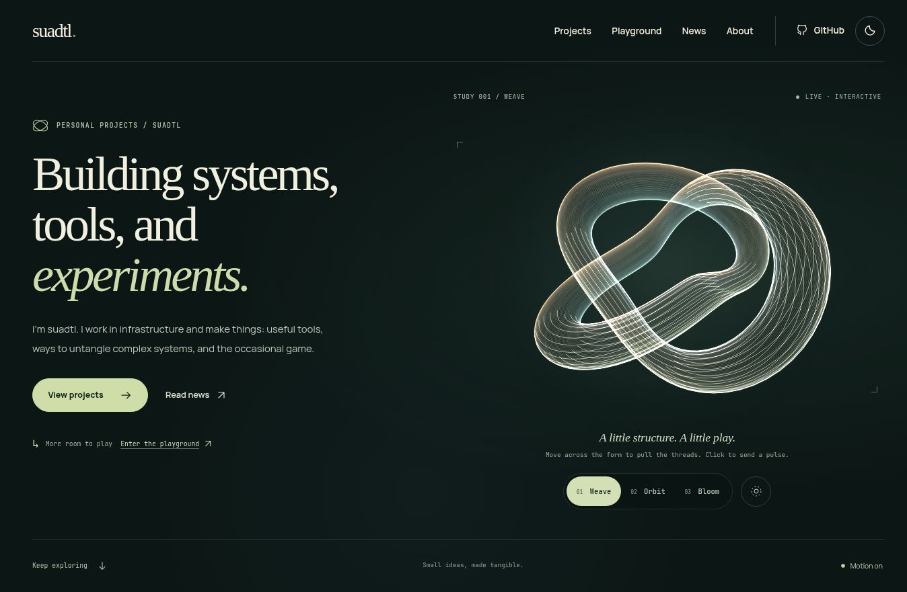
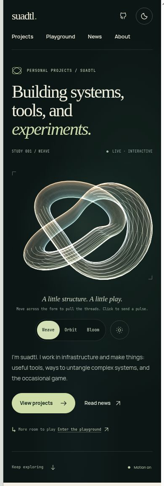
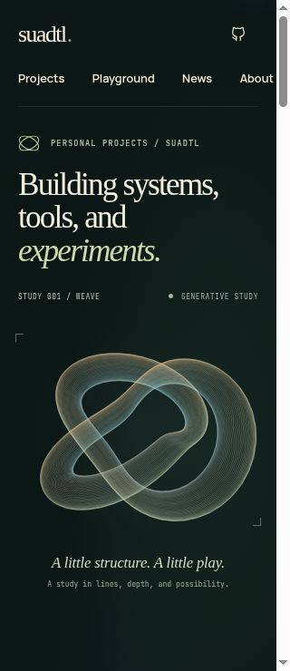

# Living hero review

## Design and scope

The homepage now introduces suadtl beside a live contour sculpture. The machinery photo and its faint generative overlay have been removed from this hero. Weave, Orbit, and Bloom are computed surfaces with smooth form transitions, pointer attraction, depth tilt, and expanding click/tap waves. The existing playground remains a separate destination.

The hero uses its own HTML/CSS/renderer boundary. News, project showcases, project destinations, SIM publication, and the older playground are unchanged. The shared machinery asset remains available to other accepted site sections.

On desktop the drawing sits beside the introduction. At tablet and phone widths it moves directly beneath the heading, before the longer introduction. At the smallest breakpoint, the typography and stage height keep the interactive controls with the artwork on the initial screen. Controls have reserved space to avoid a layout jump when enhancement becomes ready.

## Browser review

Reviewed in shared Chrome using the production Jekyll output from the first successful PR build, with the final five-line compact-layout adjustment applied before capture. The final build must contain byte-identical hero assets before this PR is marked ready.

- The live canvas replaces the SVG only after a successful draw.
- Pointer movement visibly pulls and tilts the sculpture; clicking sends a visible distortion wave.
- Native mode buttons select Weave, Orbit, and Bloom. Enter activates them and the selected form is announced.
- Motion off produces a still scene, disables pulse, and retains immediate static form selection.
- JavaScript disabled leaves the matching SVG visible, hides interactive controls, and retains page content and navigation.
- Responsive checks used nominal viewport widths 320, 390, 580, 768, 900, and 1024, plus the native desktop viewport. No horizontal page overflow was found. The 320px frame with a desktop scrollbar had 305px of content width, with the control row ending at 734px in a 740px viewport.
- The phone screenshot includes the sculpture, controls, introduction, and project/News links. The no-script screenshot shows the narrow fallback.

These are desktop-browser viewport checks, not a claim of physical-device testing. Touch input policy, system reduced motion, Save-Data, hidden tabs, and history restoration are additionally covered by the executable lifecycle harness.

## Automated checks

- `python -m unittest discover -s tests -v`: 47 tests passed locally.
- `node tests/living-hero-motion.cjs`: 11 behavioral groups, including failed canvas initialization/painting, single animation-frame ownership, all motion gates, intersection edge recovery, zero-size stages, history restoration, pointer/tap/pulse behavior, and static form changes.
- `node --check assets/living-hero.js` and `git diff --check`: passed.
- Production homepage output: three project cards, personal identity, destinations, anchors, and local assets passed.
- Production News output: 25 daily editions, 319 legacy records, 28 historical pages, and daily latest/RSS contracts passed.

Initial code head: `1b398f8ebec281f288bdc6f70957093b1cbe2b6b`.

First production build: [ArbiterForge Pages run 44222371252](https://github.com/arbiterForge/arbiterforge-site/actions/runs/44222371252). Artifact SHA-256: `7b41336dd6fb50be64b459eb3fc5df045cecc238362dc42d5a60872d1c3cb517`.

## Rendering budget

The renderer caches its three geometries, paints at up to 30 frames per second, caps its backing canvas at 1.15 million pixels, and limits the number and lifetime of distortion waves. It stops its animation frame loop when offscreen, hidden, paused, reduced motion is requested, or data saving is active. It adds no dependency, remote request, or storage access. These are enforced code budgets; hardware-specific GPU frame times have not been benchmarked.

## Screenshots

