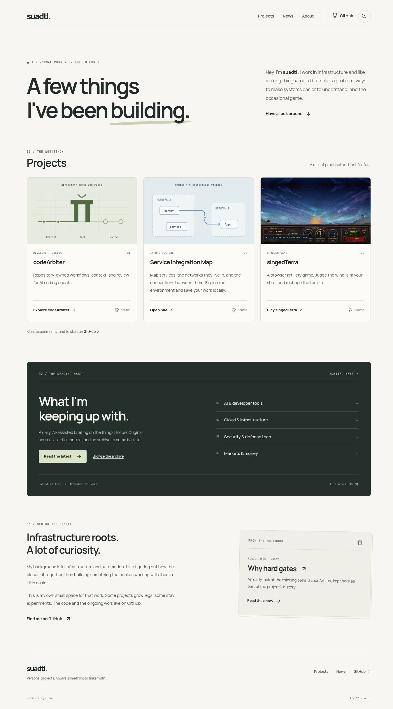
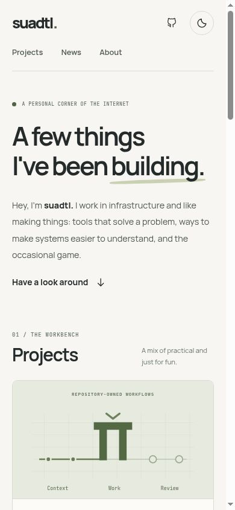
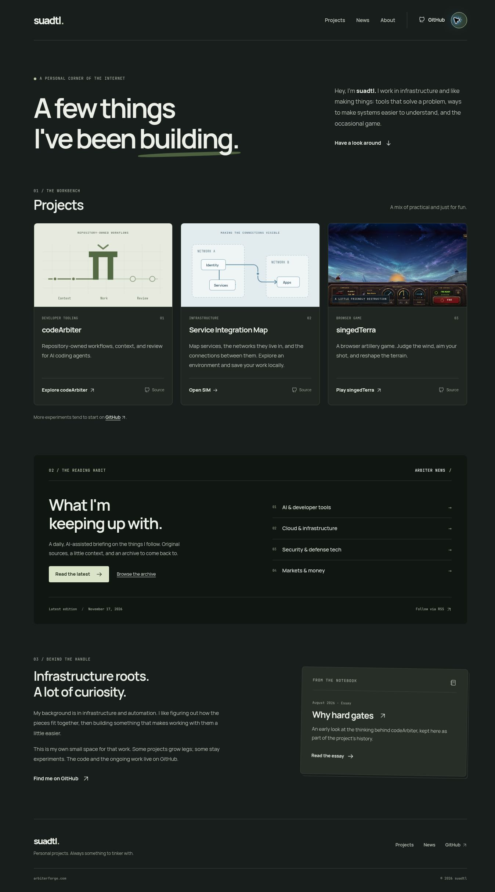

# Personal site review

Reviewed November 17, 2026 against PR #33's complete GitHub Pages artifact.

## Build identity

- Application commit: `c6aecd24fad26489cac84b97ebeefa3d0a4589d5`.
- Pages run: https://github.com/arbiterForge/arbiterforge-site/actions/runs/44152923130
- PR merge build: `5041152e16e7ba98c78a6c08461495cbcf6b3eb9`.
- Downloaded artifact SHA-256: `b5d3e17177a3c80ef1ebe5e53ca150eab51e569f180d0eed1840a9535a21250d`.

The screenshots below show the actual Jekyll output served through the managed
web preview. The review files are excluded from the production site.

## Checks

- All 33 Python source and publication checks passed.
- All three PR workflows passed: Public claim contracts, Arbiter News contracts,
  and ArbiterForge Pages.
- The rendered homepage checker verified all three project cards, their names
  and destinations, Person metadata, local assets, and internal anchors.
- The rendered News checker verified 25 published editions and 28 historical
  pages, preserving 319 legacy records and 92 restored story texts. The latest
  edition remained November 17, 2026; daily RSS excludes historical backfill.
- Desktop viewport: 1363 × 936. Additional responsive checks used same-origin
  frames at 320, 390, 768, and 1024 CSS pixels wide. None had horizontal overflow.
  These are responsive browser checks, not physical device certification.
- The dark appearance control worked and its selection survived a reload.
- The skip link received the first keyboard Tab and Enter moved focus to main.
- With scripts disabled in the review frame, all three project cards and their
  actions remained visible; the unavailable appearance control stayed hidden.
- Open SIM launched the composed application. The News Markets topic opened
  `/news/#panel-money` with only that category selected. News returned home
  through the suadtl link. The historical essay displayed its archive notice
  and current product documentation link.
- The public singedTerra destination opened its game start screen.

SIM was not modified. The artifact retained source commit
`a2b84ef19f6e1ab880c032f79190aa9b434244f7` and app SHA-256
`f7c06b267091d9e5a7926c07257219ea78c8bf4b5c56c2d916ba1fbff807203f`.

## Screenshots

### Desktop, light appearance

### Mobile, 390-pixel review frame

### Desktop, dark appearance

