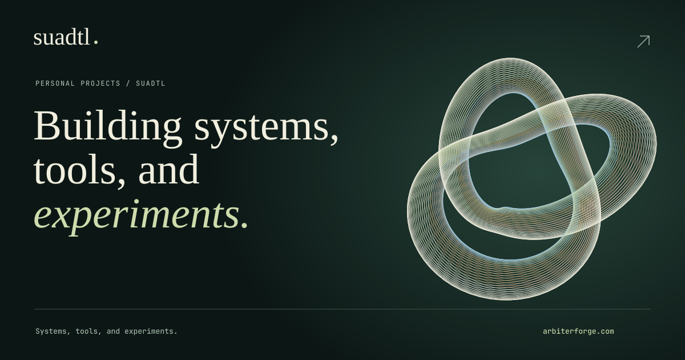

# Production polish review

This pass keeps the personal site's current visual direction and makes its
sharing, discovery, interaction and publication behavior more dependable.

## Sharing artwork

Eight original vector compositions use the site's deep green, ivory, sage and
copper palette, with a distinct subject for every destination. These are social
preview graphics, not claims of live application output.

| Destination | Sharing image |
| --- | --- |
| Homepage | `assets/social-home.png`: the living contour sculpture |
| Projects | `assets/social-projects.png`: a ring study and the three projects |
| Playground | `assets/social-lab.png`: a bloom contour study |
| News and its archive | `assets/social-news.png`: the four reading topics |
| codeArbiter | `assets/social-codearbiter.png`: Route, Evidence, Review, Decision |
| SIM | `assets/social-sim.png`: fictional service dependencies |
| singedTerra | `assets/social-singedterra.png`: an original artillery illustration |
| Essay | `assets/social-essay.png`: a notebook study of gates and evidence |

All are 1200 by 630 pixels. Vector masters are in `assets/social/`; the offline
authoring recipe is `scripts/generate_social_cards.py`. No new runtime image
generator or external image request was added.

## Search and recovery

One shared include owns titles, descriptions, canonicals, Open Graph, Twitter
cards and structured data. It describes suadtl as a person and this as a
personal website. The News landing page keeps its stable canonical address;
dated editions and historical records retain their own addresses. No invented
publication or modification timestamps are emitted.

The sitemap is generated from the same pages Jekyll builds. The custom 404 is
excluded from indexing and offers direct links back to the site. Metadata and
sharing-image checks run on the actual composed build, not only the templates.
SIM retains its independently verified upstream HTML and metadata.

## Interaction and runtime

- Identical contour geometry with shared angle samples instead of repeated
  trigonometry across every thread.
- High-frequency pointer events record coordinates; the next canvas paint reads
  current layout once. Exiting, pausing and vertical touch scrolling discard
  pending attraction.
- The fixed canvas glow is cached until a resize.
- The obsolete machinery-hero JavaScript is no longer requested by shared pages.
- The theme button reserves its space before its deferred controller starts.
  Browser theme color matches the current visual surface.
- Icon-only GitHub links keep an accessible name when narrow layouts hide text.
- The Playground's motion control stays hidden when JavaScript is unavailable.

Existing animation limits, reduced motion, Save-Data, hidden-tab/offscreen
suspension, keyboard controls and the static fallback remain in place.

An independent geometry comparison found identical Float32 coordinates for
all three forms at both resolutions. A same-machine Node microbenchmark of
geometry construction (50 iterations after warmup) measured:

| Geometry | Trigonometric calls, before / after | Median time, before / after |
| --- | --- | --- |
| Desktop | 301,808 / 2,011 | 6.873 ms / 0.263 ms |
| Compact | 171,912 / 1,547 | 3.454 ms / 0.160 ms |

These are JavaScript microbenchmarks, not browser loading times or phone results.
The lifecycle suite also checks that 100 pointer moves perform no synchronous
layout reads or paints, followed by one layout read in the next paint.

## Repeatable browser verification

The pinned Chromium suite checks the exact composed Jekyll artifact:

- Responsive routes at 320, 768 and 1440 pixels.
- Automated accessibility checks in both appearances at 320 and 1440 pixels.
- Keyboard flows, real project links, News category links, the Playground's
  shareable seed, reduced motion, no-script fallback and 404 recovery.
- Fifteen reviewed screenshots, including the homepage Projects section. A
  fixed News edition keeps routine daily publication independent of baselines.
- Three cold, touch-enabled mobile laboratory trials at 390 by 844 pixels,
  with 4x CPU slowdown, 150 ms latency and 1.6 Mbps download.

The mobile budgets are median LCP at most 2500 ms, no trial above 4000 ms, CLS
at most 0.1 and no observed scripted interaction above 200 ms. The report records
the actual observations and resource timings. Event Timing does not report
durations below 16 ms; zero recorded slow interactions is not a claim of zero
processing time. The report does not estimate field INP or real visitors'
75th-percentile Core Web Vitals. No visitor telemetry is added.

Normal CI never updates its own screenshots. A changed deployment, including
a scheduled SIM refresh, requires successful browser checks. An unchanged
poll skips the build, browser job and deployment. The existing isolated Pages
permissions and independent SIM provenance checks remain intact.

## Verification record

The final CI run, reviewed screenshots and measured mobile results are recorded
in the pull request. Physical-phone testing and real-visitor field measurements
are outside this cloud-browser review.
